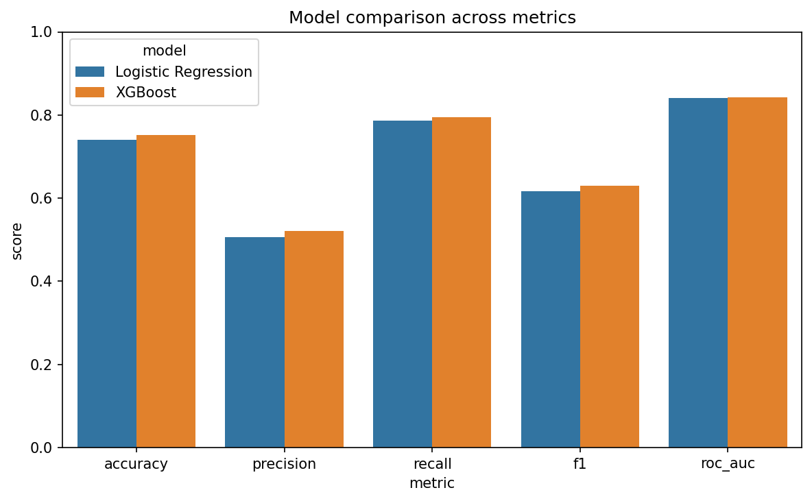
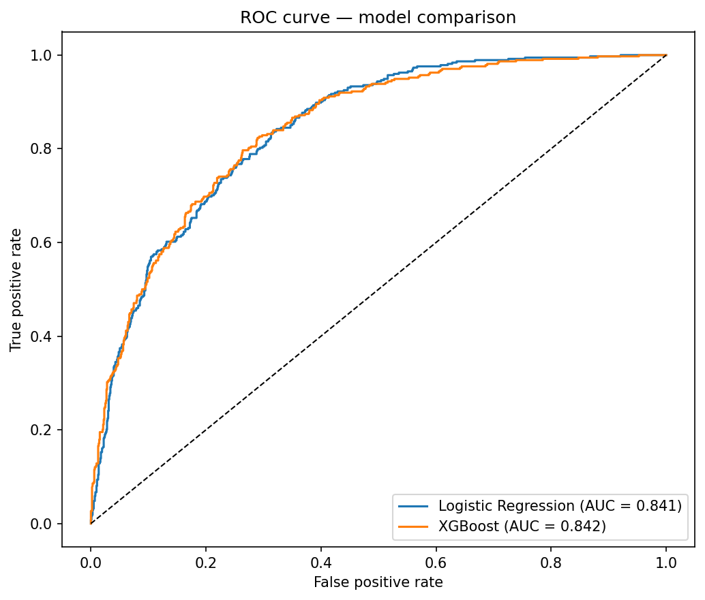
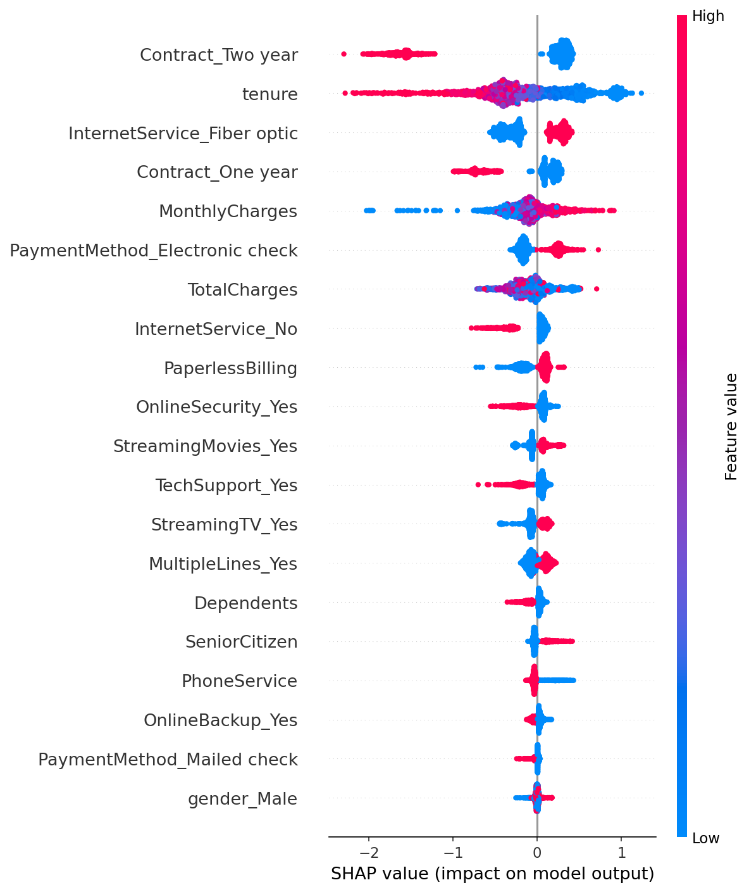
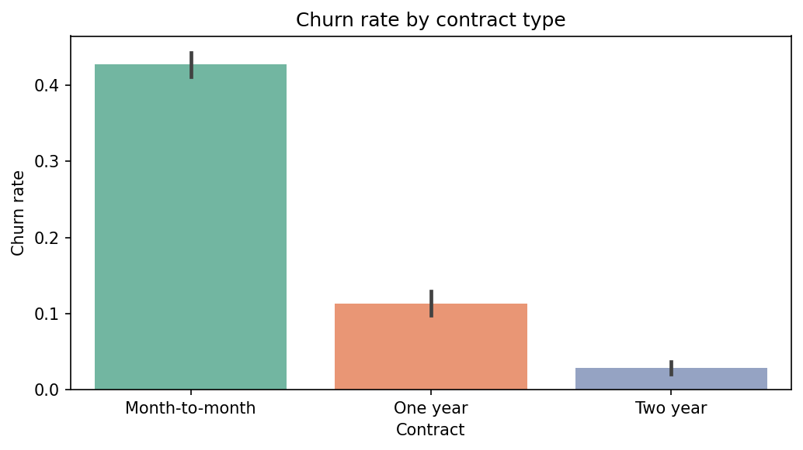

# Customer churn predictor

Predicts whether a telecom customer is likely to churn, explains *why* using SHAP,
and suggests a retention action — deployed as an interactive Streamlit app rather
than left in a notebook.

## Why this project

Most churn-prediction portfolios stop at an accuracy score. This one goes further:
it's explainable at the individual-customer level (not just "what drives churn
overall" but "why is *this* customer at risk"), it's framed around a business
decision (who to target, and with what offer), and it's something a
non-technical person could actually open and use.

## The problem

Telecom companies lose recurring revenue every time a customer cancels. Predicting
who is likely to leave — and understanding why — lets a retention team intervene
before it happens, rather than reacting after the fact.

## Data

[IBM Telco Customer Churn dataset](https://github.com/AlaaNabil98/CodeClause_Customer_Churn_Rate_Analysis)
— 7,043 customers, 21 attributes (services subscribed, contract/billing details,
tenure, demographics), with a binary churn label. This is a public, synthetic
dataset with no real customer data, so it's included directly in this repo
under `data/`.

**Note:** for a project using real/private customer data, the dataset itself
should never be committed to a public repo — describe it in the README instead
and keep it out via `.gitignore`. It's included here only because this dataset
is public and synthetic.

## Approach

1. **Preprocessing** (`src/preprocess.py`) — clean missing values (`TotalCharges`
   has blanks for brand-new customers), encode categorical features, split data.
2. **EDA** (`src/eda.py`) — explore what actually correlates with churn before
   modeling anything.
3. **Modeling** (`src/train.py`) — compare Logistic Regression (interpretable
   baseline) against XGBoost (stronger, handles non-linearity), tuned for
   **recall** over raw accuracy — see "Why recall, not accuracy" below.
4. **Explainability** (`src/explain.py`) — SHAP `TreeExplainer` for both global
   feature importance and per-customer explanations.
5. **App** (`app.py`) — Streamlit interface: enter a customer profile, get a
   churn probability, the top SHAP-driven reasons, and a suggested action.

## Results

| Model | Accuracy | Precision | Recall | F1 | ROC AUC |
|---|---|---|---|---|---|
| Logistic Regression | 0.740 | 0.507 | 0.786 | 0.616 | 0.841 |
| **XGBoost (final)** | **0.752** | **0.521** | **0.794** | **0.629** | **0.842** |



### Why recall, not accuracy

A churn model with high accuracy but low recall is close to useless in practice:
it looks good on paper while missing most of the customers actually about to
leave. Here, **XGBoost catches ~79% of customers who churn**, at the cost of
some false positives (customers flagged as at-risk who wouldn't have churned).
That tradeoff is deliberate — a false positive costs a small retention offer;
a false negative costs a lost customer. `scale_pos_weight` was used to handle
the ~3:1 class imbalance (26.5% of customers churn) rather than defaulting to
accuracy-optimized thresholds.



## What drives churn (global)



The strongest global drivers: **contract type** (month-to-month customers churn
far more than those on 1-2 year contracts — 43% vs ~3%), **tenure** (newer
customers are far more likely to leave), **fiber optic internet** (surprisingly
associated with *higher* churn — possibly pricing or service-quality related),
and **payment method** (electronic check payers churn more than automatic
payment methods).



## Per-customer explanations

Rather than only reporting a probability, the app breaks down *why* a specific
customer was flagged, using that customer's own SHAP values — the same
technique used for the global plot above, applied to one row instead of the
whole dataset. Each prediction shows the top contributing factors and their
direction (increases vs decreases risk), plus a suggested retention action
based on the dominant driver.

## Running it

```bash
pip install -r requirements.txt

# Retrain from scratch (optional — a pretrained model is already included)
python src/train.py
python src/explain.py

# Launch the app
streamlit run app.py
```

## What I'd improve with more time

- Add a proper train/validation split for hyperparameter tuning (currently
  using reasonable defaults, not a full grid search)
- Calibrate probabilities (`CalibratedClassifierCV`) so the churn percentage
  shown is a true probability, not just a ranking score
- Add cost-sensitive threshold tuning tied to actual retention-offer cost vs.
  customer lifetime value, rather than the default 0.5 cutoff
- Track model drift if this were used on live data over time

## Tech stack

`Python` `pandas` `scikit-learn` `XGBoost` `SHAP` `Streamlit` `matplotlib` `seaborn`

## Project structure

```
churn-app/
├── app.py                  # Streamlit app
├── data/
│   └── telco_churn.csv     # public dataset
├── models/                 # trained model + metadata (generated by train.py)
├── plots/                  # generated figures
├── src/
│   ├── preprocess.py       # cleaning, encoding, inference-time feature building
│   ├── eda.py               # exploratory plots
│   ├── train.py             # model training + evaluation
│   └── explain.py           # SHAP global + per-customer explanations
└── requirements.txt
```
